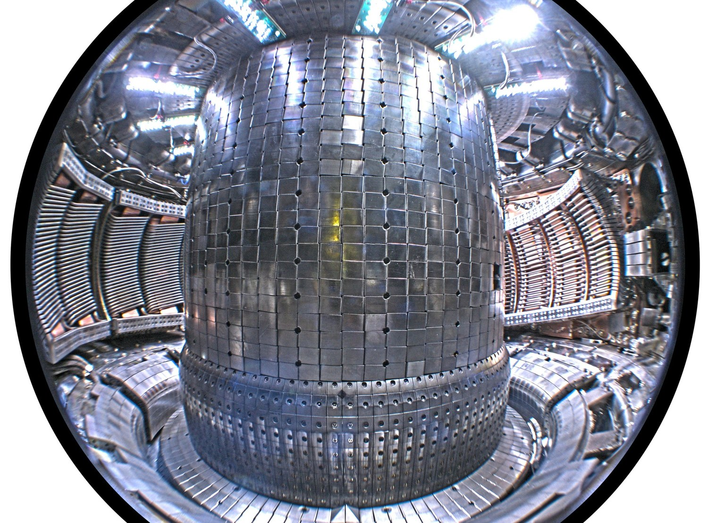

# 等离子体物理自学教材

一本从德拜屏蔽讲到聚变堆工程的自学教材：12 章正文 + 48 个附录，另有一册 47 页的配套手册。
教材共 **610 页**，四个 PDF 由同一份源码编译；`pdf/` 里目前是 2026-09-13 的 v1.33.9 旧构建，本轮源码已改、PDF 待重建。书里印出的数字都能用仓库脚本独立复算。



## 这本书是什么

**给谁读。** 物理系与工科高年级本科生、低年级研究生，以及从微电子、电气、核工程转进等离子体方向的工程师。
前置要求只有微积分、常微分方程和电磁学；等离子体本身从零讲起，不默认读者学过动理学或 MHD。

**读完能做什么。** 拿到一组 $n_e$、$T_e$、$B$，能估德拜长度、等离子体频率、回旋半径与碰撞时间；
能读懂冷等离子体色散关系、MHD 平衡与稳定性判据；能判断瑞利--泰勒、开尔文--亥姆霍兹、双流不稳定性的驱动与阈值；
能把约束时间、三重积与点火条件算成具体数；能从朗缪尔探针、光谱与微波干涉信号里读出密度和温度。

**怎么保证算得对。** 每道例题给出答案，关键公式配量纲自检，每章末尾有公式卡、概念图与随堂自测。
正文印出的数由 `check/physics_regression.py` 逐项重算，而不是从上一版抄下来。

本书没有旧版正文可供对照：它是为这套自学路线新写的，不是某本旧教材的修订版，因此不做「旧版—新版」逐句对比。
版本演进见 [`CHANGELOG.md`](CHANGELOG.md)，本轮勘误见 [`ERRATA.md`](ERRATA.md)。

## 四个 PDF

同一份源码出四个 PDF。仓库 [`pdf/`](pdf/) 里是固定文件名的四个文件；[Releases](http://zsyq.hxlab.tech:3000/yuhanxue/plasma-physics-textbook/releases) 里是历史存档，文件名带版本号，如 `plasma_physics_textbook_v1.33.9.pdf`。

> **PDF 状态：** `pdf/` 里是 **2026-09-13** 构建的 v1.33.9 旧产物（610 / 207 / 403 / 47 页）。本轮只改源码与文档，没有重出 PDF；PDF 与当前源码不同步，页数、书签与图表页码都要等下一次构建后复核。

| 分册 | 页数（2026-09-13 旧构建） | Releases 里的文件名 | 什么时候下这个 |
|---|---|---|---|
| 完整本 | 610 | `plasma_physics_textbook_vX.Y.Z.pdf` | 第一次读，或只想存一份 |
| 卷一·正文 | 207 | `plasma_physics_textbook_vX.Y.Z_vol1_chapters.pdf` | 只想通读前言与第 1–12 章 |
| 卷二·附录 | 403 | `plasma_physics_textbook_vX.Y.Z_vol2_appendices.pdf` | 正文读完，回头查 48 个附录 |
| 配套手册 | 47 | `plasma_physics_handbook_vX.Y.Z.pdf` | 边学边查学习策略、逐章对照与题库 |

三册的印刷页码与完整本一致（卷一 1–207，卷二 208–610），书签全部保留，可以在分册与完整本之间按页码对照。
每个 release 都带这四个 PDF 与该版的改动说明。

仓库内直达：[完整本](pdf/plasma_physics_textbook_v2.pdf) · [卷一](pdf/plasma_physics_textbook_v2_vol1_chapters.pdf) · [卷二](pdf/plasma_physics_textbook_v2_vol2_appendices.pdf) · [配套手册](pdf/plasma_physics_handbook.pdf)

## 内容结构

### 正文（12 章）

| 章 | 主题 | 读完你会 |
|---|---|---|
| 1 | 数学与统计力学预备知识 | 会用后面各章真正用到的那部分数学与统计工具 |
| 2 | 什么是等离子体？ | 用德拜长度、等离子体频率和判据判断「这是不是等离子体」 |
| 3 | 单粒子运动 | 会算回旋、漂移、磁镜与绝热不变量 |
| 4 | 流体描述基础 | 会从动理学走到流体方程，看清每一步丢掉了什么 |
| 5 | 磁流体力学 | 会用 MHD 方程读平衡、稳定与磁冻结 |
| 6 | 等离子体中的波 | 会算冷等离子体色散关系，认识截止与共振 |
| 7 | 动理学理论 | 会写 Vlasov 方程，理解 Landau 阻尼这类无碰撞过程 |
| 8 | 碰撞与输运 | 会估碰撞时间、电阻率与经典/新经典输运 |
| 9 | 等离子体不稳定性 | 会判断瑞利--泰勒、开尔文--亥姆霍兹与束流不稳定性的驱动和阈值 |
| 10 | 约束与受控核聚变 | 会把约束时间、三重积与点火条件算成具体数 |
| 11 | 低温工业等离子体物理 | 会算鞘层、刻蚀与镀膜的工艺窗口 |
| 12 | 等离子体基础诊断 | 会从探针、光谱与干涉信号里读出密度和温度 |

每章都带：核心目标、前置依赖、先猜再看、例题与答案、随堂自测、估算练习、量纲自检、公式卡与概念图。

### 附录（48 个）

正文 48 篇 = 工具型 A–H 8 篇 + 专题 M–AZ 40 篇（8 + 40 = 48）；配套手册 I–L 4 篇单独成册，不计入正文 48。

- **工具型 A–H（8 个，计入正文 48）**：矢量公式、特征参数速查、中间数学步骤、常数、书单、易错点、仿真导读、符号术语。
- **配套手册 I–L（4 个，不计入正文 48）**：学习策略、经典教材逐章对照、跨教材例题、分章自测题库——单独成册（47 页）。
- **专题 M–AZ（40 个，计入正文 48）**：从加热、边界、诊断、尘埃等离子体，到强场激光、聚变材料与堆系统集成；每篇 7–12 页，自带数值例子与估算练习。

正文 48 篇的页数、图表数与「还想再薄能动哪里」，见 [`docs/appendix-audit.md`](docs/appendix-audit.md)。

## 三条阅读路线

- **路线 A（零基础 / 工科·微电子）**：第 1–2 章打底 → 第 3–6 章看物理图像 → 第 11 章进工艺 → 附录 P、Q。
- **路线 B（聚变 / 空间物理）**：第 2–5 章 → 第 10 章 → 附录 M、N、S、U、Z；空间等离子体另看附录 AB。
- **路线 C（理论 / 仿真）**：第 4–9 章 → 附录 AC、AE、AF，配合附录 G 的三个仿真脚本。

## 规模与质量

- **610 页（2026-09-13 的 v1.33.9 旧构建；重建后复核）**：封面与目录 22 页、符号说明与前言 7 页、12 章正文 176 页、结语 2 页、48 个附录 403 页；配套手册 47 页。
- **118 张实拍与机构图像 + 38 张自绘图**（36 张插图，主册与手册封面各 1 张）；逐张来源见 [`figures/CREDITS.md`](figures/CREDITS.md)。
- **7195 项物理回归（发布构建口径）**：把书里印出的数字独立重算，并要求数字留在它自己那一节；本机缺 `.aux` 时为 7193 项。
- **六套门禁**：发布构建（v1.33.9，有完整 PDF 与 `.aux`）为物理回归 7195、全量结构 45、一致性 14、可读性 45、插图版式 36、书签 11，全部 FAIL 0；本机静态（2026-11-12，无 TeX）为 7193 / 32 / 15 / 32 / 36 / 10。两栏前提不同，差额来源见下表和 [`docs/QA.md`](docs/QA.md)。

| 检查 | 发布构建 | 本机静态（2026-11-12） | 管什么 |
|---|---:|---:|---|
| `check/physics_regression.py` | 7195 | 7193 | 独立重算书中数字，并核对数字所在章节 |
| `check/full_check.py` | 45 | 32 | 结构、内容、编译、PDF、一致性、分册 |
| `check/consistency_audit.py` | 14 | 15 | 符号、图表编号、README 与正文的对应 |
| `check/ui_readability.py` | 45 | 32 | 句长、段长、颜色对比度、图文距离 |
| `check/figure_layout.py` | 36 | 36 | 插图是否越界、图注与来源是否齐全 |
| `check/pdf_outline.py` | 11 | 10 | 书签层级与印刷目录页码是否对得上 |

差额口径：

- `physics_regression` 少 2 项，是缺 `src/*.aux` 时附录 F 的 2 项章号归属检查不执行；完整构建后按 7195 项核对。
- `full_check` 少 13 项，是缺 `src/*.log` 与 `src/*.pdf` 时 C（编译日志）、D（PDF 产物）两段提前返回；两条 FAIL 就是这两个文件缺失，属环境限制，不是内容错误。
- `consistency_audit` 的 14 与 15 不是环境差：14 是 PASS 项数（旧记录写法），脚本汇总 15 项，含 1 条 INFO（无索引条目）；本机静态按汇总记 15。
- `ui_readability` 少 13 项，是无 PDF 时版面/页眉类检查跳过；`pdf_outline` 少 1 项，是本机跑的是旧 PDF。
- `figure_layout` 两栏都是 36 项；本机 WARN 2，其中 1 条是缺 `.aux` 时 `fig:lawson` 页码无法核对。

本轮为源码编辑轮，没有重出 PDF；`pdf/` 仍是 2026-09-13 的 v1.33.9 旧构建，源码已改、PDF 待重建。静态检查的可复现命令与当前结果写在 [`STATUS.md`](STATUS.md)。

## 快速开始

环境：TeX Live 2024+ 或 MiKTeX，必须用 **XeLaTeX**。在 `src/` 下跑一条命令：

```bash
cd src && latexmk -xelatex -interaction=nonstopmode -f plasma_physics_textbook_v2.tex
```

产物落在 `src/`（不入 git）；交付 PDF 只放 `pdf/`。

**交付前要跑两个后处理**（源码编译不出来的部分）：

```bash
python3 tools/fix_outline_pages.py pdf/plasma_physics_textbook_v2.pdf   # 书架式书签与目录链接的页码归位
python3 tools/fix_section_links.py pdf/plasma_physics_textbook_v2.pdf   # 正文「见 §X.Y」链接的落点归位
```

两步都是因为 hyperref 在 `\section` 排版那一刻记页码：标题被挤到下一页时，书签、目录链接与正文交叉引用会一起早一页。
两个脚本各按 `.aux` 或书签的实测页码校正，跑完 `check/pdf_outline.py` 应为 FAIL 0 / WARN 0。
再按附录 A 的起始页切成卷一（1–207）与卷二（208–610），三册页码与完整本一致。

**文档里的数字也是脚本算出来的**，页数或附录体量变化后重跑这几条即可：

```bash
python3 tools/overview_fig.py                        # docs/overview.png
python3 tools/appendix_audit.py --json               # 附录体量数据
python3 tools/make_appendix_audit_doc.py --write     # docs/appendix-audit.md
python3 tools/make_figures_gallery.py --write        # docs/figures.md（图册）
```

**质量检查**：

```bash
python3 check/full_check.py --no-compile   # 结构、内容、编译、PDF、一致性
python3 check/physics_regression.py        # 重新计算书中印出的每个数字
python3 check/consistency_audit.py         # 符号、图表编号、README 对齐
python3 check/ui_readability.py            # 句长、段长、颜色对比度
python3 check/figure_layout.py             # 插图版式
python3 check/pdf_outline.py               # 书签与目录页码
```

Windows 下把 `python3` 换成 `python -X utf8`，避免中文输出编码错误。完整的环境、通过线与不可复现项见 [`docs/QA.md`](docs/QA.md)。

## 勘误与版本

当前 **v1.33.9**。版本演进与验收记录见 [`CHANGELOG.md`](CHANGELOG.md)，独立评审结论见 [`docs/review-log.md`](docs/review-log.md)。

发现数值、单位或推导错误，欢迎开 issue 并附上复算过程；补充内容优先补「能自己算一遍」的例子与练习。
本轮编辑的逐条改动、证据与未决项见 [`ERRATA.md`](ERRATA.md)；源码已改、`pdf/` 仍是 2026-09-13 旧构建、PDF 待重建的状态见 [`STATUS.md`](STATUS.md)。

## 目录结构

| 路径 | 内容 |
|---|---|
| [`src/`](src/) | 书稿源：主文件、12 章补充材料、48 个附录、配套手册 |
| [`figures/`](figures/) | 全部插图 + [`CREDITS.md`](figures/CREDITS.md) |
| [`pdf/`](pdf/) | 四个交付 PDF |
| [`docs/`](docs/) | 读者文档、架构、文风与验收说明 |
| [`check/`](check/) | 自动检查与可证伪夹具 |
| [`code/`](code/) | 书里引用的可运行脚本 |
| [`tools/`](tools/) | 生成与采集脚本；`tools/calc/` 是附录数值脚本 |
| [`README.md`](README.md) | 本页：成品、结构、构建、质量、许可 |
| [`AGENTS.md`](AGENTS.md) | 协作者（含 AI）的硬规则与索引 |
| [`CHANGELOG.md`](CHANGELOG.md) | 版本记录：每版改了什么、为什么改 |
| [`ERRATA.md`](ERRATA.md) | 勘误总台账：位置、问题、改法、证据、状态 |
| [`STATUS.md`](STATUS.md) | 当前进度：版本、本轮改动、门禁、已知问题、下一步 |

## 配图与许可

**全书视觉只有一套：深蓝打底、金色点睛，庄重克制。** 色板、用色比例、图内配色语义与版面上限写在
[`docs/palette.md`](docs/palette.md)；文风硬指标写在 [`docs/STYLE.md`](docs/STYLE.md)，目录约定见 [`docs/layout.md`](docs/layout.md)。

- 118 张实拍与机构图像，逐张登记作者、许可与来源页：[`figures/CREDITS.md`](figures/CREDITS.md)。
- 全部 118 张按章/附录排成一册：[`docs/figures.md`](docs/figures.md)；选图标准见 [`docs/figures-sourcing.md`](docs/figures-sourcing.md)。
- 许可以公有领域与 CC BY / CC BY-SA 为主；教材内容采用 **CC BY-NC-SA 4.0**，`code/` 下脚本采用 MIT。

## 参与

- 改书稿前先读 [`AGENTS.md`](AGENTS.md) 与 [`docs/STYLE.md`](docs/STYLE.md)；不要改 `\input` 路径、label 名和构建脚本的行为。
- 改完至少跑 `check/full_check.py --no-compile` 与 `check/consistency_audit.py`；数字改动还要跑 `check/physics_regression.py`。
- 长任务用进度 CLI 包装，具体命令见 [`AGENTS.md`](AGENTS.md) 的「长任务进度上报」。
- 图片来源、许可与版式要求见 [`docs/figures-sourcing.md`](docs/figures-sourcing.md) 与 [`docs/palette.md`](docs/palette.md)。

感谢 Wikimedia Commons 的摄影师与 NASA、ESA、ITER、JET、EUROfusion、NIFS、PPPL、ORNL、CEA 等机构公开的图片与数据。
