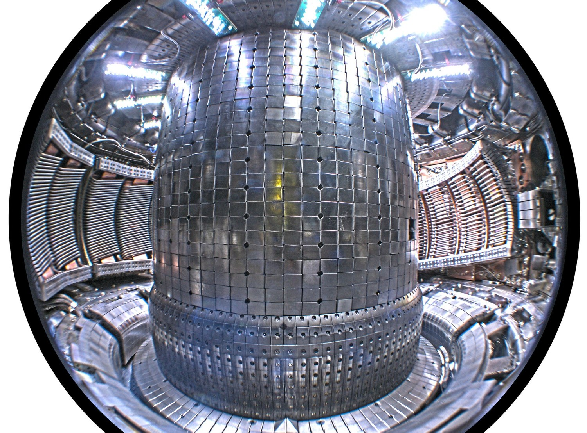
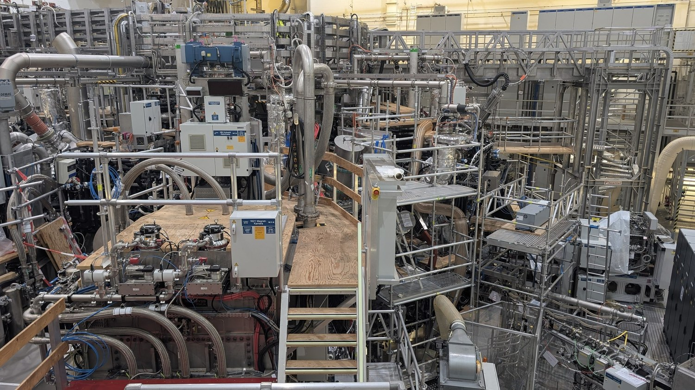
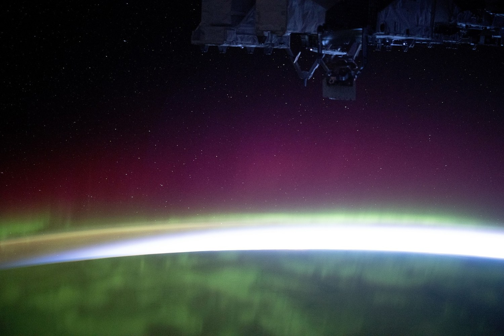
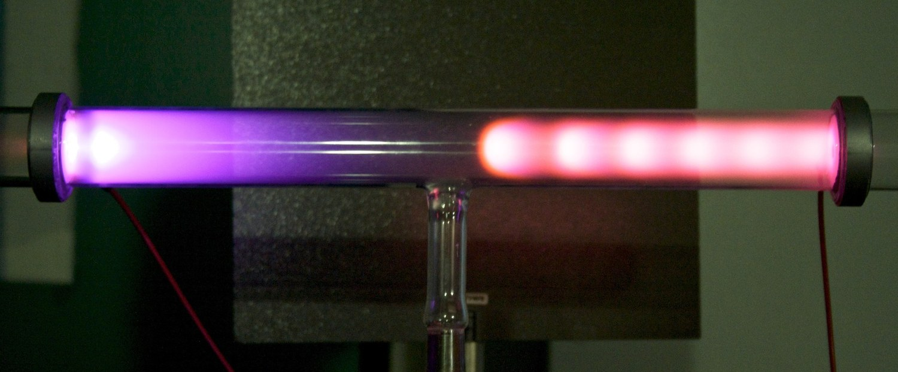
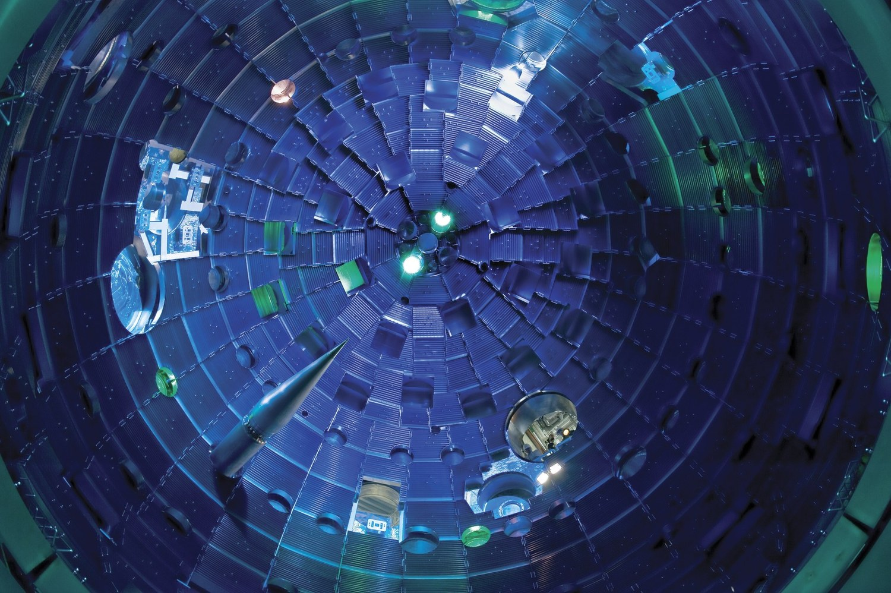
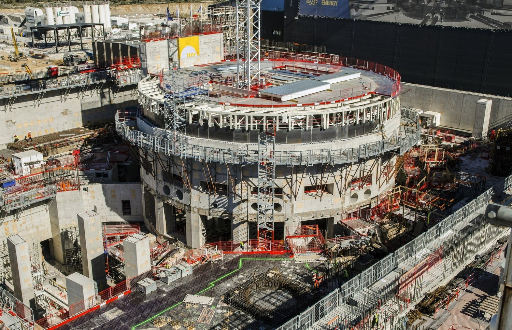

# 等离子体物理自学教材

一本写给自学者看的等离子体物理教材：从德拜屏蔽讲到聚变堆工程，12 章正文 + 48 个附录（另有一册配套手册）。
每道例题配答案，关键公式配量纲自检，书里印出的数字都能用仓库脚本复算。



教材共 **609 页**，四个 PDF 都由本仓库源码编译。写作目标：**一个人、一支笔、一台能算数的电脑就能读完**。

## 四个 PDF

同一份源码出四个 PDF。仓库 [`pdf/`](pdf/) 里是固定文件名的四个文件（随版本更新）；[Releases](http://zsyq.hxlab.tech:3000/yuhanxue/plasma-physics-textbook/releases) 里是历史存档，文件名带版本号，如 `plasma_physics_textbook_v1.32.0.pdf`。

| 分册 | 页数 | Releases 里的文件名 | 什么时候下这个 |
|---|---|---|---|
| 完整本 | 609 | `plasma_physics_textbook_vX.Y.Z.pdf` | 第一次读，或只想存一份 |
| 卷一·正文 | 206 | `plasma_physics_textbook_vX.Y.Z_vol1_chapters.pdf` | 只想通读前言与第 1–12 章 |
| 卷二·附录 | 403 | `plasma_physics_textbook_vX.Y.Z_vol2_appendices.pdf` | 正文读完，回头查 48 个附录 |
| 配套手册 | 48 | `plasma_physics_handbook_vX.Y.Z.pdf` | 边学边查学习策略、逐章对照与题库 |

三册的印刷页码与完整本一致（卷一 1–206，卷二 207–609），书签全部保留，可以在分册与完整本之间按页码对照。
每个 release 都带这四个 PDF 与该版的改动说明。

仓库内直达：[完整本](pdf/plasma_physics_textbook_v2.pdf) · [卷一](pdf/plasma_physics_textbook_v2_vol1_chapters.pdf) · [卷二](pdf/plasma_physics_textbook_v2_vol2_appendices.pdf) · [配套手册](pdf/plasma_physics_handbook.pdf)

## 先看几张图

全书用了 118 张实拍与机构图像（另有随正文编译的 TikZ 示意图）：

| | |
|---|---|
| <br>仿星器 W7-X：靠线圈扭出磁面 | <br>极光：磁层把能量送进电离层 |
| <br>辉光放电：低温等离子体的入门装置 | <br>NIF 靶室：惯性约束的毫米级燃料仓 |
| <br>ITER 建设现场 | <br>等离子弧切割：工业侧的应用 |

逐张的作者、许可与来源页见 [`figures/CREDITS.md`](figures/CREDITS.md)；想一页看完项目规模与检查结果，见 [`docs/overview.md`](docs/overview.md)。

## 内容结构

### 正文（12 章）

| 章 | 主题 | 读完你会 |
|---|---|---|
| 1 | 数学与统计力学预备知识 | 会用后面各章真正用到的那部分数学与统计工具 |
| 2 | 什么是等离子体？ | 用德拜长度、等离子体频率和判据判断"这是不是等离子体" |
| 3 | 单粒子运动 | 会算回旋、漂移、磁镜与绝热不变量 |
| 4 | 流体描述基础 | 会从动理学走到流体方程，看清每一步丢掉了什么 |
| 5 | 磁流体力学 | 会用 MHD 方程读平衡、稳定与磁冻结 |
| 6 | 等离子体中的波 | 会算冷等离子体色散关系，认识截止与共振 |
| 7 | 动理学理论 | 会写 Vlasov 方程，理解 Landau 阻尼这类无碰撞过程 |
| 8 | 碰撞与输运 | 会估碰撞时间、电阻率与经典/新经典输运 |
| 9 | 等离子体不稳定性 | 会判断交换模、撕裂模、束流不稳定性的驱动与阈值 |
| 10 | 约束与受控核聚变 | 会把约束时间、三重积与点火条件算成具体数 |
| 11 | 低温工业等离子体物理 | 会算鞘层、刻蚀与镀膜的工艺窗口 |
| 12 | 等离子体基础诊断 | 会从探针、光谱与干涉信号里读出密度和温度 |

### 附录（48 个）

- **工具型 A–H（8 个）**：矢量公式、特征参数速查、中间数学步骤、常数、书单、易错点、仿真导读、符号术语。
- **配套手册 I–L（4 个）**：学习策略、经典教材逐章对照、跨教材例题、分章自测题库——单独成册（48 页）。
- **专题 M–AZ（40 个）**：从加热、边界、诊断、尘埃等离子体，到强场激光、聚变材料与堆系统集成；
  每篇 7–12 页，自带数值例子与估算练习。

48 篇的页数、图表数与"还想再薄能动哪里"，见 [`docs/appendix-audit.md`](docs/appendix-audit.md)。

## 怎么读

- **路线 A（零基础 / 工科·微电子）**：第 1–2 章打底 → 第 3–6 章看物理图像 → 第 11 章进工艺 → 附录 P、Q。
- **路线 B（聚变 / 空间物理）**：第 2–5 章 → 第 10 章 → 附录 M、N、S、U、Z；或附录 AB（空间等离子体）。
- **路线 C（理论 / 仿真）**：第 4–9 章 → 附录 AC、AE、AF，配合附录 G 的三个仿真脚本。

每章都带：核心目标、前置依赖、先猜再看、例题与答案、随堂自测、估算练习、量纲自检、公式卡与概念图。

## 怎么构建

环境：TeX Live 2024+ 或 MiKTeX，必须用 **XeLaTeX**。在 `src/` 下跑一条命令：

```bash
cd src && latexmk -xelatex -interaction=nonstopmode -f plasma_physics_textbook_v2.tex
```

产物落在 `src/`（不入 git）；交付 PDF 只放 `pdf/`。已知限制见 [`CHANGELOG.md`](CHANGELOG.md)。

## 质量检查

```bash
python -X utf8 check/full_check.py --no-compile   # 结构、内容、编译、PDF、一致性
python -X utf8 check/physics_regression.py        # 重新计算书中印出的每个数字
```

另有 `check/ui_readability.py`（可读性）、`check/consistency_audit.py`（一致性）、
`check/figure_layout.py`（插图版式）、`check/pdf_outline.py`（书签与目录）。

## 配图与许可

**全书视觉只有一套：深蓝打底、金色点睛，庄重克制。** 色板、用色比例、图内配色语义与版面上限写在
[`docs/palette.md`](docs/palette.md)；文风硬指标写在 [`docs/style.md`](docs/style.md)，目录约定见 [`docs/layout.md`](docs/layout.md)。

- 118 张实拍与机构图像，逐张登记作者、许可与来源页：[`figures/CREDITS.md`](figures/CREDITS.md)。
- 全部 118 张按章/附录排成一册：[`docs/figures.md`](docs/figures.md)；选图标准见 [`docs/figures-sourcing.md`](docs/figures-sourcing.md)。
- 许可以公有领域与 CC BY / CC BY-SA 为主；教材内容采用 **CC BY-NC-SA 4.0**，`code/` 下脚本采用 MIT。

## 仓库导航

| 路径 | 内容 |
|---|---|
| [`src/`](src/) | 书稿源：主文件、12 章补充材料、48 个附录、配套手册 |
| [`figures/`](figures/) | 全部插图 + [`CREDITS.md`](figures/CREDITS.md) |
| [`pdf/`](pdf/) | 四个交付 PDF |
| [`docs/`](docs/) | 读者文档（一览、图册、体检表、规范与评审记录） |
| [`check/`](check/) | 自动检查与可证伪夹具 |
| [`code/`](code/) | 书里引用的可运行脚本 |
| [`tools/`](tools/) | 生成与采集脚本；`tools/calc/` 是附录数值脚本 |
| [`CHANGELOG.md`](CHANGELOG.md) | 版本记录：每版改了什么、为什么改 |
| [`AGENTS.md`](AGENTS.md) | 协作者约定 |

## 版本与反馈

当前 **v1.32.9**；版本演进与验收记录见 [`CHANGELOG.md`](CHANGELOG.md)，独立评审结论见 [`docs/review-log.md`](docs/review-log.md)。

发现数值、单位或推导错误，欢迎开 issue 并附上复算过程；补充内容优先补"能自己算一遍"的例子与练习。

感谢 Wikimedia Commons 的摄影师与 NASA、ESA、ITER、JET、EUROfusion、NIFS、PPPL、ORNL、CEA 等机构公开的图片与数据。
