# 图册：全书 95 张插图一览

> 这本书用图讲物理：全书 95 张插图，全部是实拍照片或公开示意图，逐张登记了作者、许可与来源页。
> 下面按「章 / 附录」把它们排开，点击任意一张可看原图；完整清单与来源链接见 [`figures/CREDITS.md`](../figures/CREDITS.md)。

合计 **107 张**。若想按来源查看（NASA、ITER、LLNL、EUROfusion…），见文末统计。

## 第 1 章（1 张）

| 图 | 说明 | 作者 | 许可与来源 |
|---|---|---|---|
| 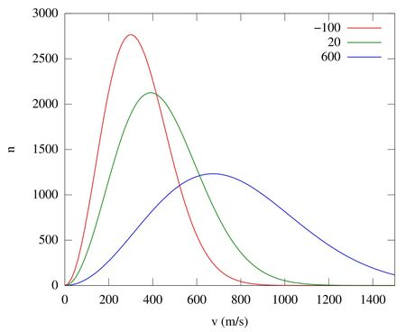 | 麦克斯韦速率分布：分布函数的第一课 | InverseHypercube | CC BY-SA 3.0（[来源页](https://commons.wikimedia.org/wiki/File:Maxwell-Boltzmann_distribution.svg)） |

## 第 2 章（6 张）

| 图 | 说明 | 作者 | 许可与来源 |
|---|---|---|---|
| 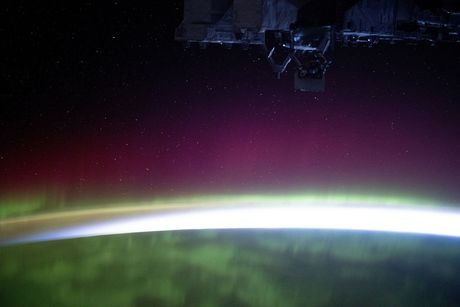 | 国际空间站拍摄的极光（高层大气被沉降粒子激发） | NASA Johnson Space Center | Public domain（[来源页](https://commons.wikimedia.org/wiki/File:The_aurora_borealis_blankets_the_Earth_(iss072e159516).jpg)） |
| 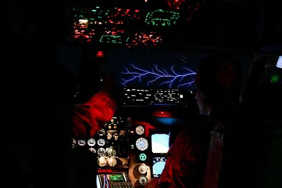 | 圣艾尔摩之火：大气中的电晕放电 | U.S. Air Force / Tech. Sgt. Diana Cossaboom | Public domain（[来源页](https://commons.wikimedia.org/wiki/File:KC-135_Stratotanker_pilots_experience_the_phenomenon_of_St._Elmo%E2%80%99s_Fire.jpg)） |
| 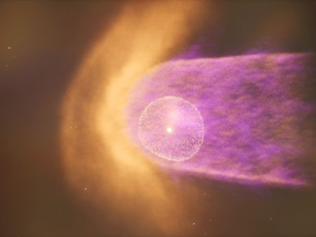 | 太阳风与日球层（NASA 科学可视化） | NASA's Scientific Visualization Studio | Public domain（[来源页](https://commons.wikimedia.org/wiki/File:The_Heliosphere_Within_The_Milky_Way_Galaxy_(SVS20406_-_x24_Print_nolabels).png)） |
| 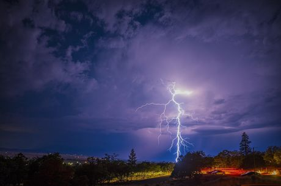 | 云地闪电通道：大气中最容易看见的等离子体 | The Modern Polymath | CC BY 4.0（[来源页](https://commons.wikimedia.org/wiki/File:Cloud-to-ground_lightning_strike.jpg)） |
| 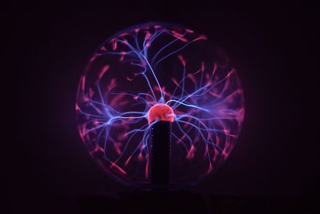 | 等离子体球：低压惰性气体中的放电丝 | Stbuccia | CC BY-SA 4.0（[来源页](https://commons.wikimedia.org/wiki/File:Lateral_Plasma_Ball.jpg)） |
| 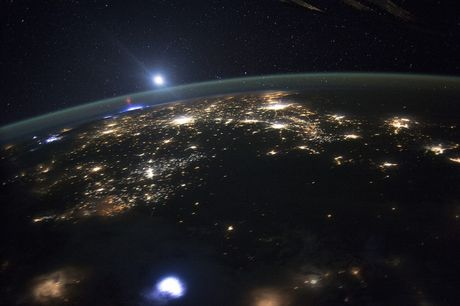 | 红色精灵（ISS 实拍）：平流层的向上放电 | NASA | Public domain（[来源页](https://commons.wikimedia.org/wiki/File:ISS-44_Red_Sprites,_northwest_Mexico.jpg)） |

## 第 3 章（3 张）

| 图 | 说明 | 作者 | 许可与来源 |
|---|---|---|---|
| 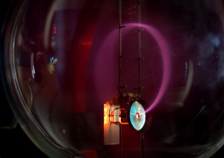 | 电子束在磁场中弯成圆形轨迹（真实回旋运动） | Marcin Białek | CC BY-SA 4.0（[来源页](https://commons.wikimedia.org/wiki/File:Cyclotron_motion.jpg)） |
| 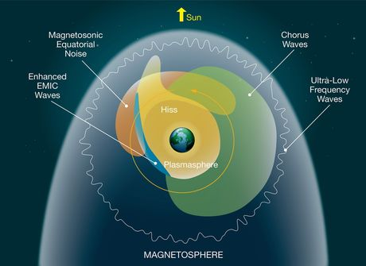 | 地球磁层与等离子体波（弓激波、磁尾、辐射带） | NASA's Goddard Space Flight Center | Public domain（[来源页](https://commons.wikimedia.org/wiki/File:NASA_magnetosphere_plasma_waves_diagram.png)） |
| 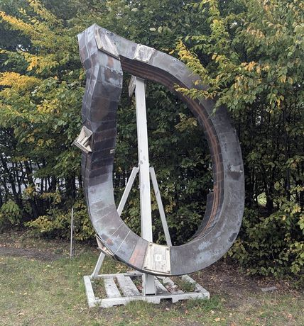 | 仿星器的非平面线圈：三维磁场的几何来源 | Siarhei Besarab | CC BY-SA 4.0（[来源页](https://commons.wikimedia.org/wiki/File:A_non-planar_coil_from_the_Wendelstein_7-X_stellarator.jpg)） |

## 第 4 章（2 张）

| 图 | 说明 | 作者 | 许可与来源 |
|---|---|---|---|
| 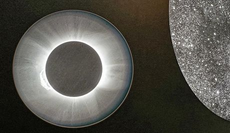 | 日冕仪拍摄的日冕物质抛射：等离子体裹着磁场抛出 | Burkhard Mücke | CC BY-SA 4.0（[来源页](https://commons.wikimedia.org/wiki/File:Coronal_Mass_Ejection.jpg)） |
| 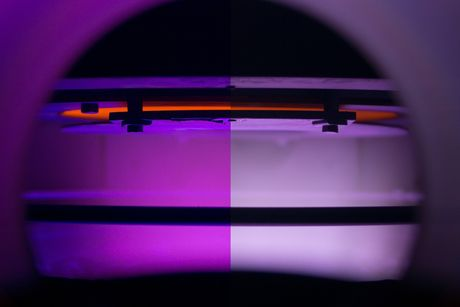 | 等离子体增强化学气相沉积腔内的放电 | Barzandr | CC BY-SA 4.0（[来源页](https://commons.wikimedia.org/wiki/File:LEPECVD_plasma.png)） |

## 第 5 章（2 张）

| 图 | 说明 | 作者 | 许可与来源 |
|---|---|---|---|
| 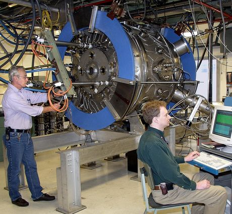 | 普林斯顿 MRX 磁重联实验装置（环面等离子体） | U.S. Department of Energy | Public domain（[来源页](https://commons.wikimedia.org/wiki/File:U.S._Department_of_Energy_-_Science_-_413_002_002_(9952381664).jpg)） |
| 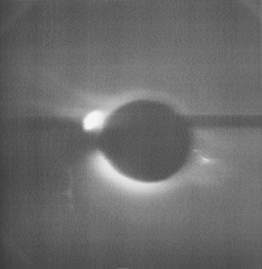 | 日冕与日珥（白光日冕仪，等离子体沿磁力线成环） | NASA Johnson Space Center | Public domain（[来源页](https://commons.wikimedia.org/wiki/File:Solar_corona-prominence_seen_through_the_White_Light_Coronograph_(s74-15697).jpg)） |

## 第 6 章（2 张）

| 图 | 说明 | 作者 | 许可与来源 |
|---|---|---|---|
|  | 太阳风与磁层耦合：波把能量从太阳风送进磁层 | Space Travel Blog / Rute Marta Jansone | CC BY 4.0（[来源页](https://commons.wikimedia.org/wiki/File:Sun-Earth_Interaction.jpg)） |
| 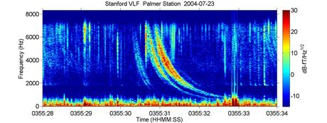 | VLF 频谱图：哨声波的下降调谐色散曲线 | drdan14 | CC BY-SA 3.0（[来源页](https://commons.wikimedia.org/wiki/File:Whistler_radio_palmer_2004-07-23_T035528.png)） |

## 第 7 章（2 张）

| 图 | 说明 | 作者 | 许可与来源 |
|---|---|---|---|
| 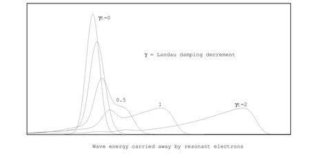 | 朗道阻尼：共振粒子把波的能量带走 | Ramin Rahimi / Commons 贡献者 | CC BY-SA 3.0（[来源页](https://commons.wikimedia.org/wiki/File:Landau-damp.png)） |
| 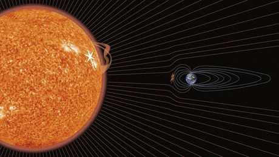 | 太阳风与地球磁层的全球动理学模拟（Vlasiator） | Space Travel Blog / Rute Marta Jansone | CC BY 4.0（[来源页](https://commons.wikimedia.org/wiki/File:Sun-Earth_Interaction.jpg)） |

## 第 8 章（2 张）

| 图 | 说明 | 作者 | 许可与来源 |
|---|---|---|---|
| 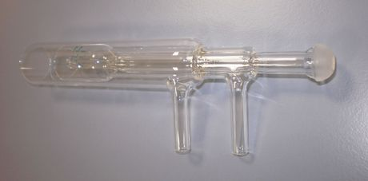 | 电感耦合等离子体炬：欧姆加热的可见结果 | Superchilum | CC BY-SA 3.0（[来源页](https://commons.wikimedia.org/wiki/File:ICP_quartz_torch_1.JPG)） |
| 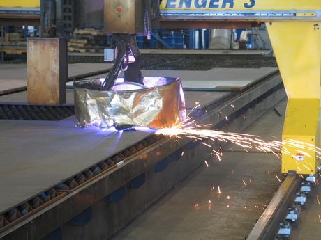 | 等离子弧切割：电流被电阻率限制 | Loffredo | CC BY-SA 4.0（[来源页](https://commons.wikimedia.org/wiki/File:STEP-NC_plasma_cutting.jpg)） |

## 第 9 章（2 张）

| 图 | 说明 | 作者 | 许可与来源 |
|---|---|---|---|
| 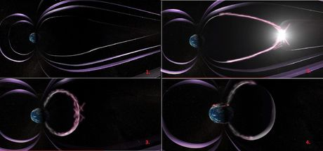 | 磁重联示意：磁力线断开并重新连接 | NASA | Public domain（[来源页](https://commons.wikimedia.org/wiki/File:Magnetic_reconnection.png)） |
| 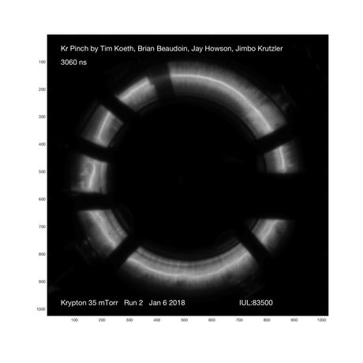 | 环形箍缩装置中的氪等离子体（100 ns 曝光） | Timkoeth | CC BY-SA 4.0（[来源页](https://commons.wikimedia.org/wiki/File:TWK_pinch.jpg)） |

## 第 10 章（7 张）

| 图 | 说明 | 作者 | 许可与来源 |
|---|---|---|---|
| 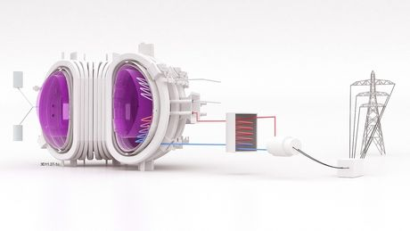 | 聚变电站全系统示意：包层、氚循环、汽轮机与发电机 | EUROfusion | CC BY 4.0（[来源页](https://commons.wikimedia.org/wiki/File:EUROfusion_schematic_diagram_of_fusion_power_plant.jpg)） |
| 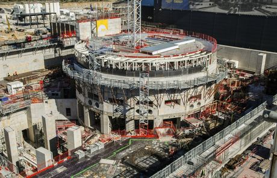 | ITER 建设现场（2018 年，托卡马克基坑与厂房） | Oak Ridge National Laboratory | CC BY 2.0（[来源页](https://commons.wikimedia.org/wiki/File:ITER_construction_in_2018_(41809718461).jpg)） |
| 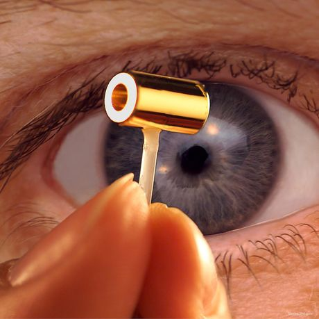 | NIF 黑腔实物：金圆柱内壁与燃料靶丸（毫米级） | Lawrence Livermore National Laboratory | Public domain（[来源页](https://commons.wikimedia.org/wiki/File:Nif_hohlraum.jpg)） |
| 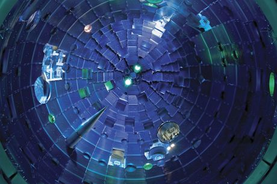 | 美国国家点火装置（NIF）靶室（10 m 直径、激光入口阵列） | Lawrence Livermore National Laboratory | CC BY-SA 3.0（[来源页](https://commons.wikimedia.org/wiki/File:National_Ignition_Facility's_target_chamber.jpg)） |
| 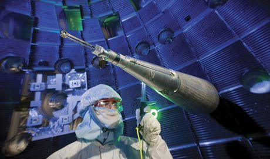 | NIF 靶室内部：一个人站在十米级球室里 | Lawrence Livermore National Security | CC BY-SA 3.0（[来源页](https://commons.wikimedia.org/wiki/File:Worker_inside_the_target_chamber_of_the_National_Ignition_Facility.jpg)） |
| 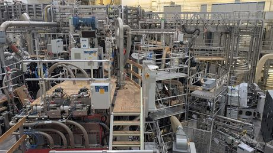 | Wendelstein 7-X 仿星器实验大厅（非平面线圈环） | Siarhei Besarab | CC BY-SA 4.0（[来源页](https://commons.wikimedia.org/wiki/File:Experimental_hall_of_the_Wendelstein_7-X_stellarator_at_IPP_Greifswald_03.jpg)） |
| 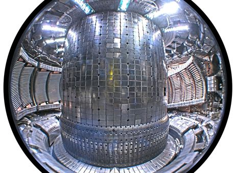 | Alcator C-Mod 托卡马克真空室内景（含石墨瓦与磁体结构） | Mike Garrett / MIT Plasma Science and Fusion Center | CC BY 3.0（[来源页](https://commons.wikimedia.org/wiki/File:Alcator_C-Mod_Tokamak_Interior.jpg)） |

## 第 11 章（4 张）

| 图 | 说明 | 作者 | 许可与来源 |
|---|---|---|---|
| 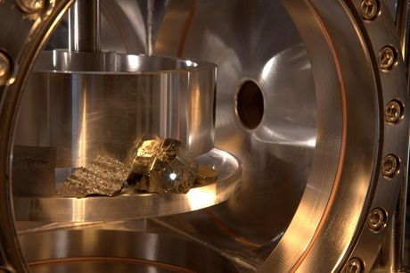 | 火星上的激光等离子体：ChemCam 的 LIBS 光谱 | NASA/JPL-Caltech/LANL | Public domain（[来源页](https://commons.wikimedia.org/wiki/File:ChemCam_Plasma_Iron_Pyrite.jpg)） |
| 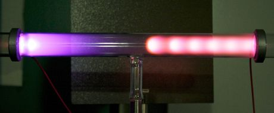 | 直流辉光放电管：阴极暗区、负辉光、法拉第暗区、正柱区 | Chetvorno | CC BY-SA 2.0（[来源页](https://commons.wikimedia.org/wiki/File:Glow_discharge_regions.jpg)） |
| 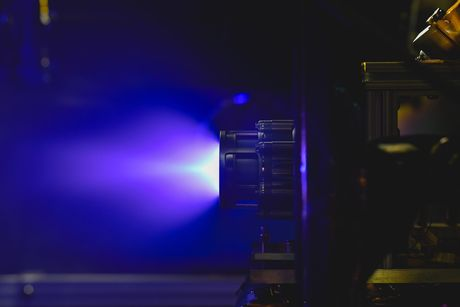 | 霍尔推力器点火（氪工质，羽流为电离气体） | MrAdamJohnson | CC BY-SA 4.0（[来源页](https://commons.wikimedia.org/wiki/File:Orbion_Hall-effect_thruster_firing_on_krypton.jpg)） |
| 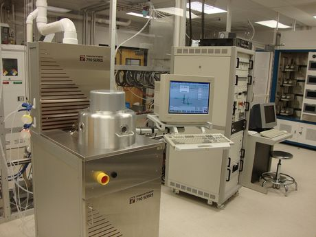 | 反应离子刻蚀设备：低温等离子体的工业用法 | AlabamaUSA | CC BY-SA 3.0（[来源页](https://commons.wikimedia.org/wiki/File:Reactive_Ion_Etcher.JPG)） |

## 第 12 章（3 张）

| 图 | 说明 | 作者 | 许可与来源 |
|---|---|---|---|
| 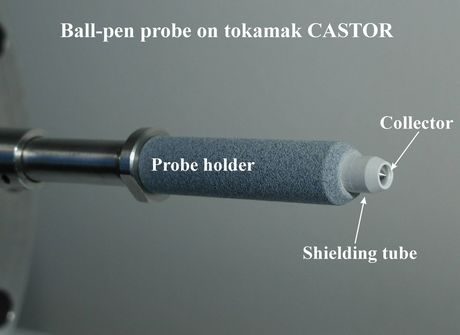 | 朗缪尔探针头部：收集极套在氮化硼陶瓷管内 | Jiri Adamek, IPP ASCR | CC BY-SA 3.0（[来源页](https://commons.wikimedia.org/wiki/File:BPP_probe_head.png)） |
| 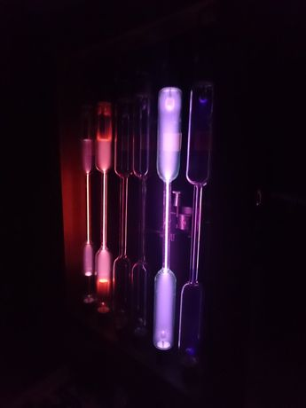 | 盖斯勒放电管：谱线是被放电点亮的 | Svk mary | CC BY-SA 4.0（[来源页](https://commons.wikimedia.org/wiki/File:Geissler_spectrum_tube.JPG)） |
| 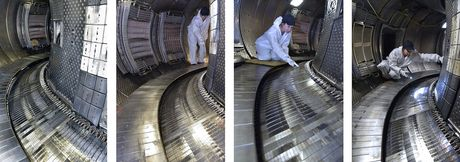 | WEST 托卡马克偏滤器的在位检查 | Hélène Roche / CEA IRFM | CC BY 4.0（[来源页](https://commons.wikimedia.org/wiki/File:Divertor_tokamak_WEST.jpg)） |

## 附录 AA（2 张）

| 图 | 说明 | 作者 | 许可与来源 |
|---|---|---|---|
| 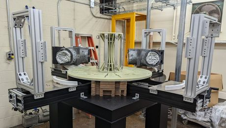 | MUSE 永磁仿星器装配 | T. M. Qian 等（MUSE 团队） | CC BY 4.0（[来源页](https://commons.wikimedia.org/wiki/File:Design_and_construction_of_the_MUSE_permanent_magnet_stellarator_-_Fig20.jpg)） |
| 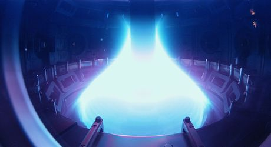 | MAST 球形托卡马克：中心柱换来的高比压 | Eye Steel Film | CC BY 2.0（[来源页](https://commons.wikimedia.org/wiki/File:MAST_Tokamak_(32476489303).jpg)） |

## 附录 AB（2 张）

| 图 | 说明 | 作者 | 许可与来源 |
|---|---|---|---|
| 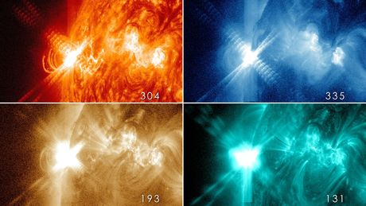 | 太阳耀斑（SDO 四波段）：日冕里的磁重联 | NASA/SDO | Public domain（[来源页](https://commons.wikimedia.org/wiki/File:X3.2_Solar_flare_on_2013-05-14_at_four_wavelengths.jpg)） |
| 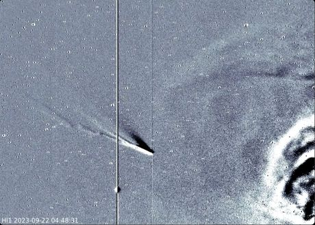 | 西村彗星的离子尾：太阳风把彗尾吹成一条直线 | STEREO/NASA（内日球成像仪 HI-1） | Public domain（[来源页](https://commons.wikimedia.org/wiki/File:Cometnishimura.png)） |

## 附录 AC（1 张）

| 图 | 说明 | 作者 | 许可与来源 |
|---|---|---|---|
| 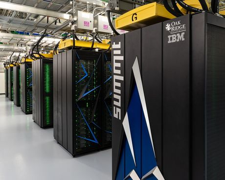 | 超级计算机：粒子步总账最终要在这里付 | Carlos Jones/ORNL | CC BY 2.0（[来源页](https://commons.wikimedia.org/wiki/File:Summit_(supercomputer).jpg)） |

## 附录 AD（1 张）

| 图 | 说明 | 作者 | 许可与来源 |
|---|---|---|---|
|  | 托卡马克真空室内壁与限制器 | Mike Garrett | CC BY 3.0（[来源页](https://commons.wikimedia.org/wiki/File:Alcator_C-Mod_Tokamak_Interior.jpg)） |

## 附录 AE（2 张）

| 图 | 说明 | 作者 | 许可与来源 |
|---|---|---|---|
| 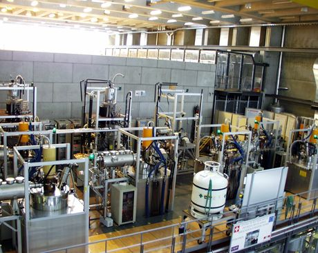 | 回旋管：用电子回旋运动产生毫米波 | Rama | CC BY-SA 2.5（[来源页](https://commons.wikimedia.org/wiki/File:Gyrotron_plateforme.jpg)） |
| 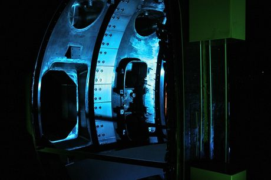 | ASDEX Upgrade 的极向截面 | Nico Kaiser | CC BY-SA 2.0（[来源页](https://commons.wikimedia.org/wiki/File:ASDEX_Upgrade_section_(1567515317).jpg)） |

## 附录 AF（2 张）

| 图 | 说明 | 作者 | 许可与来源 |
|---|---|---|---|
| 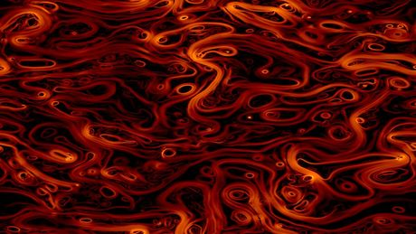 | 磁湍流：输运由哪一段波数贡献 | Giannandrea Inchingolo | CC BY-SA 4.0（[来源页](https://commons.wikimedia.org/wiki/File:Magnetic_turbulence.jpg)） |
| 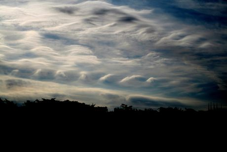 | 开尔文–亥姆霍兹不稳定性的云街 | Brocken Inaglory | CC BY-SA 3.0（[来源页](https://commons.wikimedia.org/wiki/File:Kelvin-Helmholtz_instability_clouds.JPG)） |

## 附录 AG（2 张）

| 图 | 说明 | 作者 | 许可与来源 |
|---|---|---|---|
| 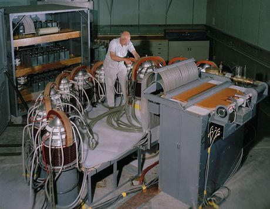 | θ 箍缩 Scylla I（1958）：最早的磁约束实验之一 | Unknown LANL photographer | Public domain（[来源页](https://commons.wikimedia.org/wiki/File:Scylla_I_in_1958.jpg)） |
| 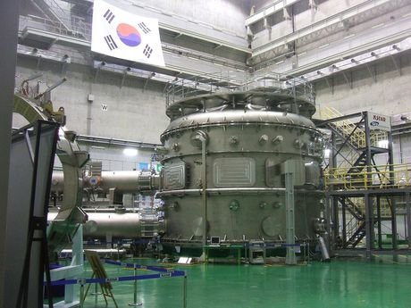 | KSTAR 超导托卡马克装置本体 | Michel Maccagnan | CC BY-SA 3.0（[来源页](https://commons.wikimedia.org/wiki/File:KSTAR_tokamak.jpg)） |

## 附录 AH（2 张）

| 图 | 说明 | 作者 | 许可与来源 |
|---|---|---|---|
| 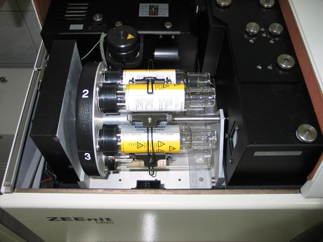 | 空心阴极灯：谱线是被激发出来的 | Szasza | CC BY-SA 3.0（[来源页](https://commons.wikimedia.org/wiki/File:Hollow_cathode_lamp.JPG)） |
| 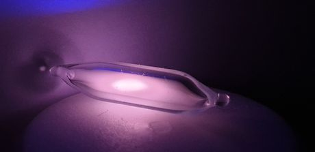 | 放电管里被激发的氦 | Alicepublic | CC BY-SA 4.0（[来源页](https://commons.wikimedia.org/wiki/File:Angeregtes_Helium_3.jpg)） |

## 附录 AI（2 张）

| 图 | 说明 | 作者 | 许可与来源 |
|---|---|---|---|
| 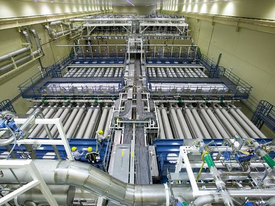 | 激光驱动器阵列：192 束光要在靶上对准 | Lawrence Livermore National Laboratory | Public domain（[来源页](https://commons.wikimedia.org/wiki/File:NIF_Laser_Bay.jpg)） |
| 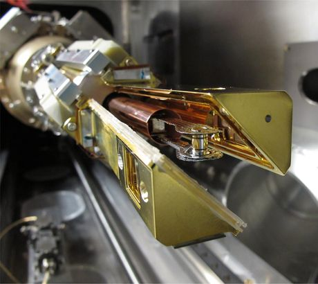 | NIF 靶装配体：黑腔与燃料靶丸 | Lawrence Livermore National Laboratory | CC BY-SA 3.0（[来源页](https://commons.wikimedia.org/wiki/File:NIF_ignition_target_assembly.jpg)） |

## 附录 AJ（1 张）

| 图 | 说明 | 作者 | 许可与来源 |
|---|---|---|---|
|  | 弹丸注入器：把燃料冻成弹丸打进去 | Oak Ridge National Laboratory | CC BY 2.0（[来源页](https://commons.wikimedia.org/wiki/File:ITER_Prototype_3-barrel_shattered_pellet_injector_(14132373814).jpg)） |

## 附录 AK（2 张）

| 图 | 说明 | 作者 | 许可与来源 |
|---|---|---|---|
|  | 干式贮存罐：活化废物最后的去处 | Nuclear Regulatory Commission from US | CC BY 2.0（[来源页](https://commons.wikimedia.org/wiki/File:Massive_containers_hold_spent_nuclear_fuel_(15420175144).jpg)） |
|  | 热室里的远程操作机械臂 | Idaho National Laboratory | CC BY 2.0（[来源页](https://commons.wikimedia.org/wiki/File:Manipulator_Arm.jpg)） |

## 附录 AL（2 张）

| 图 | 说明 | 作者 | 许可与来源 |
|---|---|---|---|
|  | 直布罗陀海峡的内孤立波 | NASA / 国际空间站宇航员（2004） | Public domain（[来源页](https://commons.wikimedia.org/wiki/File:Solitons,_Strait_of_Gibraltar_(4585).jpg)） |
|  | 激光自聚焦与成丝：Kerr 自聚焦 → 细丝 → 等离子体通道（示意图） | Ikarion | CC BY-SA 4.0（[来源页](https://commons.wikimedia.org/wiki/File:Laser_filamentation.png)） |

## 附录 AM（2 张）

| 图 | 说明 | 作者 | 许可与来源 |
|---|---|---|---|
|  | ITER 中心螺线管的绕制 | Oak Ridge National Laboratory | CC BY 2.0（[来源页](https://commons.wikimedia.org/wiki/File:ITER_central_solenoid_manufacturing_(41809722361).jpg)） |
|  | 仿星器磁体系统示意：线圈怎么排、力往哪里走 | M. Nagel, C.P. Dhard, H. Bau, H.-S. Bosch, U. Meyer, S. Raatz, K. Risse and T. Rummel | CC BY 3.0（[来源页](https://commons.wikimedia.org/wiki/File:Wendelstein_7-X_schematic_view_of_magnets_system.jpg)） |

## 附录 AN（2 张）

| 图 | 说明 | 作者 | 许可与来源 |
|---|---|---|---|
|  | SPEXone 偏振仪：把偏振当成一个诊断量 | NASA | Public domain（[来源页](https://commons.wikimedia.org/wiki/File:SPEXone_Polarimeter_for_the_PACE_satellite_-_GSFC_20201021_PACE_32369.jpg)） |
|  | 方解石的双折射 | Masha Milshina | CC BY 4.0（[来源页](https://commons.wikimedia.org/wiki/File:Birefringence_of_calcite.jpg)） |

## 附录 AO（3 张）

| 图 | 说明 | 作者 | 许可与来源 |
|---|---|---|---|
|  | NASA Chamber A 热真空室 | NASA / Johnson Space Center | Public domain（[来源页](https://commons.wikimedia.org/wiki/File:NEO_Surveyor_Instrument_Enclosure_Inside_Historic_Chamber_A_(PIA26583).jpg)） |
|  | 真空舱里的霍尔推力器：抽气与壁条件决定它能不能点着 | EXOTRAIL SA | CC BY-SA 4.0（[来源页](https://commons.wikimedia.org/wiki/File:Hall_Effect_Thruster_in_a_vacuum_chamber.jpg)） |
|  | 涡轮分子泵：抽速是泵与导管一起决定的 | Moxfyre | CC BY-SA 4.0（[来源页](https://commons.wikimedia.org/wiki/File:Edwards_turbopump.jpg)） |

## 附录 AP（2 张）

| 图 | 说明 | 作者 | 许可与来源 |
|---|---|---|---|
|  | JET 的遥操作机械臂：远距离操作的真实尺度 | Steve Parker from Ash Vale, UK | CC BY 2.0（[来源页](https://commons.wikimedia.org/wiki/File:JET_Mascot_(1466933452).jpg)） |
|  | WEST 装置的新扇区集成 | Christophe Roux / IRFM | CC BY 4.0（[来源页](https://commons.wikimedia.org/wiki/File:Intégration_nouveau_secteur_-_Tokamak_WEST.jpg)） |

## 附录 AQ（2 张）

| 图 | 说明 | 作者 | 许可与来源 |
|---|---|---|---|
|  | 激光干涉仪 | Logg Tandy | CC BY 4.0（[来源页](https://commons.wikimedia.org/wiki/File:HP-5518A_Laser_Interferometer.jpg)） |
|  | 精密激光干涉仪的光学台 | NASA | Public domain（[来源页](https://commons.wikimedia.org/wiki/File:NASA_Tests_LISA_Development_Units_(SVS14955_-_LISA_TVAC).jpg)） |

## 附录 AR（2 张）

| 图 | 说明 | 作者 | 许可与来源 |
|---|---|---|---|
|  | 20 MW 飞轮储能电站：能量存在转子里 | Z22 | CC BY-SA 4.0（[来源页](https://commons.wikimedia.org/wiki/File:Beacon_Power_New_York_-_20_MW_Flywheel_Energy_Storage.jpg)） |
|  | 电容储能组 | Rubin Observatory/NSF/AURA | CC BY 4.0（[来源页](https://commons.wikimedia.org/wiki/File:Capacitor_Banks_(rubin-photo-oct-04-9-38-25-am).jpg)） |

## 附录 AS（1 张）

| 图 | 说明 | 作者 | 许可与来源 |
|---|---|---|---|
|  | 光学台：射线方程在这里被验证 | Giorgio Brida from Torino, Italy | CC BY 2.0（[来源页](https://commons.wikimedia.org/wiki/File:Femtosecond_Laser_and_Pulse_Compressor_-_Optics_Lab_-_INRIM.jpg)） |

## 附录 AT（2 张）

| 图 | 说明 | 作者 | 许可与来源 |
|---|---|---|---|
|  | 回旋管：电子回旋共振加热的功率源 | Siarhei Besarab | CC BY-SA 4.0（[来源页](https://commons.wikimedia.org/wiki/File:Gyrotron_for_electron_cyclotron_resonance_heating_of_the_Wendelstein_7-X_stellarator.jpg)） |
|  | ITER 的 ECRH 转向镜 | Anastasia Xydou | CC BY 4.0（[来源页](https://commons.wikimedia.org/wiki/File:ITER_ECRH_Steering_mirrors.jpg)） |

## 附录 AU（2 张）

| 图 | 说明 | 作者 | 许可与来源 |
|---|---|---|---|
|  | 黑体辐射源：误差棒的另一端是标准 | Luminforum | CC BY 4.0（[来源页](https://commons.wikimedia.org/wiki/File:Black_body_radiator_at_CARLO_laboratory_in_Poland.jpg)） |
|  | 示波器上的波形 | Pittigrilli | CC BY-SA 4.0（[来源页](https://commons.wikimedia.org/wiki/File:Tektronix_Oscilloscope_475A.jpg)） |

## 附录 AV（1 张）

| 图 | 说明 | 作者 | 许可与来源 |
|---|---|---|---|
|  | 氚发光环：半衰期与活度摸得着的样子 | Cgommel | CC BY-SA 2.0 de（[来源页](https://commons.wikimedia.org/wiki/File:Tritium-Glowring_-_320s.jpg)） |

## 附录 AW（2 张）

| 图 | 说明 | 作者 | 许可与来源 |
|---|---|---|---|
|  | 桑迪亚 Z 装置 | ENERGY.GOV | Public domain（[来源页](https://commons.wikimedia.org/wiki/File:The_Z_Machine_(8056998596).jpg)） |
|  | Orion 激光装置的靶室 | Colin N. Danson 等 | CC BY 4.0（[来源页](https://commons.wikimedia.org/wiki/File:Orion_target_chamber.jpg)） |

## 附录 AX（2 张）

| 图 | 说明 | 作者 | 许可与来源 |
|---|---|---|---|
|  | AWAKE：质子束驱动的等离子体尾场 | E. Adli 等（AWAKE 合作组，Nature 561, 363） | CC BY 4.0（[来源页](https://commons.wikimedia.org/wiki/File:41586_2018_485_Fig1_HTML.webp)） |
|  | TRIUMF 回旋加速器：回旋运动的工程尺度 | Adam Foster | CC BY-SA 2.0（[来源页](https://commons.wikimedia.org/wiki/File:Canadian_Science_-_TRIUMF_cyclotron_-_Flickr_-_Cargo_Cult_(1).jpg)） |

## 附录 AY（3 张）

| 图 | 说明 | 作者 | 许可与来源 |
|---|---|---|---|
|  | W7-X 偏滤器碳瓦安装 | Christopher Roux / EUROfusion | CC BY 4.0（[来源页](https://commons.wikimedia.org/wiki/File:W7-X_tile_installation.jpg)） |
|  | 离子辐照实验：dpa 是怎么被制造出来的 | BibMak | CC BY-SA 4.0（[来源页](https://commons.wikimedia.org/wiki/File:The_irradiation_experiments_at_the_ion_accelerator_DC-60._Astana,_Kazakhstan.JPG)） |
|  | 等离子体喷涂：给面向等离子体部件做涂层 | Student-julia-pwr | CC BY-SA 4.0（[来源页](https://commons.wikimedia.org/wiki/File:Plasma_spraying_process.jpg)） |

## 附录 AZ（1 张）

| 图 | 说明 | 作者 | 许可与来源 |
|---|---|---|---|
|  | ITER 主机厂房建设实景（2018） | Cedarstrand / ITER Organization | CC BY 2.0（[来源页](https://commons.wikimedia.org/wiki/File:ITER_construction_in_2018_(41809718461).jpg)） |

## 附录 M（2 张）

| 图 | 说明 | 作者 | 许可与来源 |
|---|---|---|---|
|  | 140 GHz / 1 MW 回旋管：射频加热三件套里的一件 | Z6ehswhha5HGRTd | CC BY-SA 4.0（[来源页](https://commons.wikimedia.org/wiki/File:Wendelstein_7-X,_Gyrotron,140Ghz,_1MW.jpg)） |
|  | 离子源：中性束注入的第一步 | Z22 | CC BY-SA 4.0（[来源页](https://commons.wikimedia.org/wiki/File:Ion_source_at_used_in_the_Cockcroft-Walton_accelerators_at_Fermilab.jpg)） |

## 附录 N（2 张）

| 图 | 说明 | 作者 | 许可与来源 |
|---|---|---|---|
|  | 磁控溅射枪：受控的溅射侵蚀 | Tavoromann | CC BY-SA 4.0（[来源页](https://commons.wikimedia.org/wiki/File:Magnetron_sputtering_gun.jpg)） |
|  | JET 的下偏滤器结构 | X. Litaudon 等（JET 团队） | CC BY 3.0（[来源页](https://commons.wikimedia.org/wiki/File:Joint_European_Torus_sub-divertor_structure.jpg)） |

## 附录 O（2 张）

| 图 | 说明 | 作者 | 许可与来源 |
|---|---|---|---|
|  | NASA NEXT 离子推力器 | NASA | Public domain（[来源页](https://commons.wikimedia.org/wiki/File:NASA_NEXT_Ion_thruster.712983main_NEXT_LDT_Thrusterhi-res_full.jpg)） |
|  | 磁喷嘴推进概念图（PPPL） | Elle Starkman / PPPL | Public domain（[来源页](https://commons.wikimedia.org/wiki/File:PPPL_physicist_Fatima_Ebrahimi_in_front_of_an_artist%27s_conception_of_a_fusion_rocket.jpg)） |

## 附录 P（2 张）

| 图 | 说明 | 作者 | 许可与来源 |
|---|---|---|---|
|  | 电晕放电管 | BentaxGermany | CC BY-SA 3.0（[来源页](https://commons.wikimedia.org/wiki/File:Ionization_tube_with_corona.jpg)） |
|  | 等离子体喷涂陶瓷涂层 | Optimi3e | CC BY-SA 4.0（[来源页](https://commons.wikimedia.org/wiki/File:Plasma_spray_ceramic_coating_on_aluminium_tube.jpg)） |

## 附录 Q（2 张）

| 图 | 说明 | 作者 | 许可与来源 |
|---|---|---|---|
|  | 射频补偿朗缪尔探针 | Vadmalis | CC BY-SA 3.0（[来源页](https://commons.wikimedia.org/wiki/File:RF_Probe_2.jpg)） |
|  | WEST 上的诊断准直 | Christophe Roux / CEA IRFM | CC BY 4.0（[来源页](https://commons.wikimedia.org/wiki/File:WEST_Tokamak_diagnostic_alignement.jpg)） |

## 附录 R（2 张）

| 图 | 说明 | 作者 | 许可与来源 |
|---|---|---|---|
|  | 尘埃等离子体诊断实验台：第三个尺度 | Stanislav Liubauskas | CC BY 4.0（[来源页](https://commons.wikimedia.org/wiki/File:Laboratory_of_Dust_Plasma_Diagnostics.jpg)） |
|  | 尘埃等离子体中的颗粒 | Mixxy 2m | CC BY 4.0（[来源页](https://commons.wikimedia.org/wiki/File:Dusty_plasma.jpg)） |

## 附录 S（2 张）

| 图 | 说明 | 作者 | 许可与来源 |
|---|---|---|---|
|  | TCV 托卡马克真空室 | TCV 团队（Commons 页面未署名） | CC BY-SA 2.5（[来源页](https://commons.wikimedia.org/wiki/File:TCV-img1502-0006.jpg)） |
|  | EAST 托卡马克的等离子体 | Xiang Gao 等（EAST 团队） | CC BY 3.0（[来源页](https://commons.wikimedia.org/wiki/File:EAST_Tokamak_plasma_images.jpg)） |

## 附录 T（2 张）

| 图 | 说明 | 作者 | 许可与来源 |
|---|---|---|---|
|  | LHD 大型螺旋装置：旋转变换由线圈给出 | National Institute for Fusion Science (NIFS) | CC BY-SA 4.0（[来源页](https://commons.wikimedia.org/wiki/File:Large_Helical_Device_2014.jpg)） |
|  | 太阳表面的磁环：磁通量管在自然界的样子 | NASA/Goddard Space Flight Center/SDO | CC BY 2.0（[来源页](https://commons.wikimedia.org/wiki/File:Magnetic_loops_on_the_sun.jpg)） |

## 附录 U（1 张）

| 图 | 说明 | 作者 | 许可与来源 |
|---|---|---|---|
|  | NOVA 靶室 | Lawrence Livermore National Laboratory | Public domain（[来源页](https://commons.wikimedia.org/wiki/File:Nova_target_chamber.jpg)） |

## 附录 V（2 张）

| 图 | 说明 | 作者 | 许可与来源 |
|---|---|---|---|
|  | 面向等离子体部件的侵蚀与再沉积 | Christophe Roux / CEA IRFM | CC BY 4.0（[来源页](https://commons.wikimedia.org/wiki/File:Composant_face_au_plasma.jpg)） |
|  | 碎裂弹丸试验台 | Oak Ridge National Laboratory | CC BY 2.0（[来源页](https://commons.wikimedia.org/wiki/File:Shattered_pellet_test_stand_(41809719871).jpg)） |

## 附录 W（1 张）

| 图 | 说明 | 作者 | 许可与来源 |
|---|---|---|---|
|  | JET 装置（1991） | EFDA JET | CC BY-SA 3.0（[来源页](https://commons.wikimedia.org/wiki/File:The_JET_magnetic_fusion_experiment_in_1991.jpg)） |

## 附录 X（1 张）

| 图 | 说明 | 作者 | 许可与来源 |
|---|---|---|---|
|  | 同步辐射储存环 | CLS Research Office from Saskatoon, Canada | CC BY-SA 2.0（[来源页](https://commons.wikimedia.org/wiki/File:Storage_ring_(13390679434).jpg)） |

## 附录 Y（1 张）

| 图 | 说明 | 作者 | 许可与来源 |
|---|---|---|---|
|  | Shiva 激光靶室 | Lawrence Livermore National Laboratory | Public domain（[来源页](https://commons.wikimedia.org/wiki/File:Shiva_target_chamber_1978.jpg)） |

## 附录 Z（1 张）

| 图 | 说明 | 作者 | 许可与来源 |
|---|---|---|---|
|  | 堆与厂：主机之外还有一整套系统 | Oak Ridge National Laboratory | CC BY 2.0（[来源页](https://commons.wikimedia.org/wiki/File:ITER_Tokamak_and_Plant_Systems_(2016)_(41783636452).jpg)） |

## 来源统计

- 政府机构、国家实验室与大学/研究所：**44 张**（NASA、ESA/SDO、ITER、LLNL、INL、EUROfusion、USAF、KSTAR 等）
- 个人摄影师、企业与开放社区：**63 张**

许可只用两种：**公有领域**与 **CC BY / CC BY-SA**（可商用、可改、需署名）。

---

生成：`python -X utf8 tools/make_figures_gallery.py --write`（数据取自 `figures/CREDITS.md`，缩略图在 `docs/figures-thumbs/`）。
