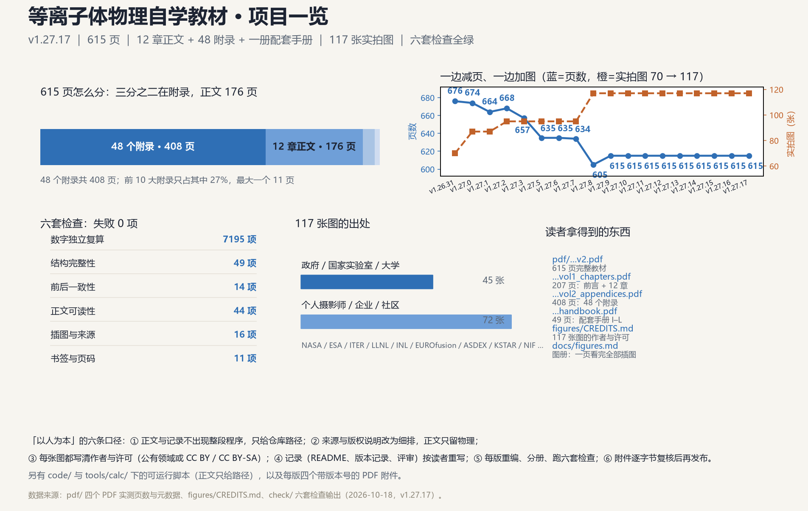

# 项目一览（一页看完这本书和这个仓库）



上图可直接点开看大图；下面是把图里的数字用文字再说一遍，方便检索与复制。全书 118 张图按章/附录排开见 [`figures.md`](figures.md)。

## 这本书现在是什么

| | |
|---|---|
| 规模 | **609 页**：12 章正文 175 页（p30–204）+ 结语 2 页（p205–206）+ 48 个附录 403 页（p207–609），前面是封面与目录 22 页、符号说明与前言 7 页；「边查边用」的附录 I／J／K／L 收在 48 页的配套手册里。检索靠 565 条 PDF 书签加附录 H 的符号与术语总表 |
| 配图 | **118 张实拍照片或公开示意图** + **38 张自画图**（按「深蓝 + 金」重绘）；实拍图逐张登记作者、许可与来源页（[`figures/CREDITS.md`](../figures/CREDITS.md)），自画图规范见 [`palette.md`](palette.md) |
| 交付 | 四个 PDF：[完整本 609 页](../pdf/plasma_physics_textbook_v2.pdf)、[卷一 206 页](../pdf/plasma_physics_textbook_v2_vol1_chapters.pdf)、[卷二 404 页](../pdf/plasma_physics_textbook_v2_vol2_appendices.pdf)、[配套手册 48 页](../pdf/plasma_physics_handbook.pdf) |
| 版本 | v1.32.13；每版都发到 [Gitea releases](http://zsyq.hxlab.tech:3000/yuhanxue/plasma-physics-textbook/releases) |
| 动手 | 正文不印程序，需要动手的地方只给路径：[`code/`](../code/)、[`tools/calc/`](../tools/calc/) |

## 版面是怎么变的

- 页数：**676 → 674 → 664 → 668 → 657 → 635 → 634 → 605 → 604 → 615 → 612 → 613 → 608 → 609 → 610 → 609**（v1.26.31 → v1.32.5）。其中 657 → 635 是把附录 J／K／L 移进配套手册，634 → 605 是把附录 I 也移了进去、605 → 604 是措辞终检时收紧的一页；634 是换掉一张坏图后自然少的一页；604 → 615 是最后几轮补图（v1.27.14–v1.27.19）。减页靠的是把"交代来源与版权"
  的文字改成细排、删掉每节重复的复算交代、收紧间距，**没有删掉任何物理内容**。
- 图数：**70 → 87 → 95 → 101 → 107 → 113 → 117 → 118**。图越换越实、越换越新（NET 装置、ITER 主机厂房、NSTX-U 加热束等）。
- 唯一的例外是 v1.27.2：补了 8 张图，页数从 664 回到 668；v1.27.3 又用版面手段收了回来。

## 质量门：六套检查，失败 0 项

| 检查 | 项数 | 管什么 |
|---|---:|---|
| `check/physics_regression.py` | 7195 | 把书里印出的数字**独立重算**一遍，并要求数字留在它自己那一节 |
| `check/full_check.py` | 49 | 结构、内容、编译、PDF、一致性、分册 |
| `check/consistency_audit.py` | 14 | 符号、图表编号、README 与正文的对应 |
| `check/ui_readability.py` | 44 | 句长、段长、颜色对比度、图文距离 |
| `check/figure_layout.py` | 16 | 插图是否越界、图注与来源是否齐全 |
| `check/pdf_outline.py` | 11 | 书签层级与印刷目录页码是否对得上 |

跑法（Windows 下先设 UTF-8，否则中文输出会崩）：

```bash
python -X utf8 check/full_check.py --no-compile
python -X utf8 check/physics_regression.py
```

## 附录体检：还想再薄，能动哪里

见 [`appendix-audit.md`](appendix-audit.md)——48 个附录逐个体检，并列出还能动的地方
与"动内容必须同步改断言"的代价说明。
